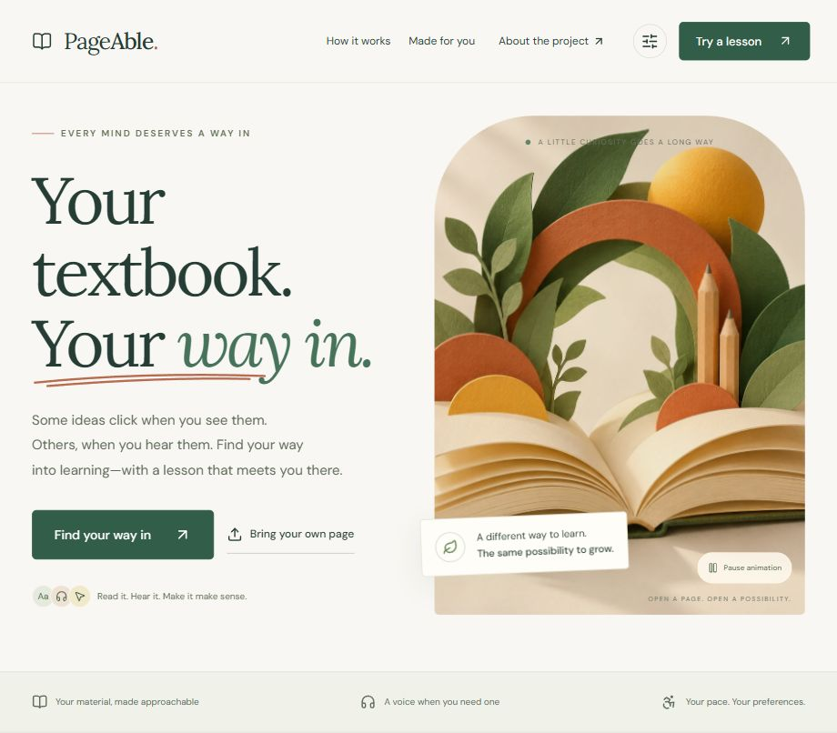
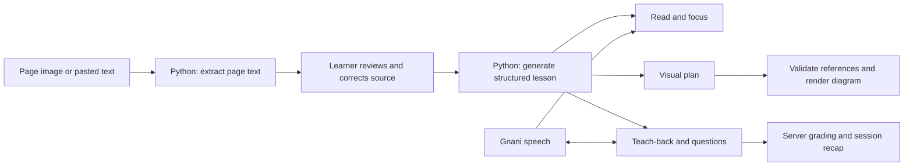

<div align="center">

# StudyLens
### Your textbook. Your way in.

Turn a textbook page into an explanation you can **read, explore visually, listen to, explain back, and practise**.

**Interactive textbook lessons with visual walkthroughs and voice questions**

**Built by Priyanshu Gupta**

[Problem & solution](#the-problem) · [Features](#what-you-can-do) · [Run locally](#run-locally) · [Architecture](#how-it-works) · [Verification](#verification-and-results) · [Demo](#a-three-minute-demo)

</div>

---



[View the full screenshot from the original prototype](docs/screenshots/homepage-full.jpg)

## The problem

A printed textbook usually offers one presentation of an idea. A learner may need shorter passages, a diagram they can explore, spoken explanations, larger text, or a chance to explain the idea in their own words. Switching between separate tools also separates explanations from the page they came from.

StudyLens gives learners control over presentation and interaction. It does not infer a disability, diagnose learning needs, or claim that an accessibility preference establishes a learning style.

## The solution

Upload a readable page image or paste its text. Check the extracted words, then build a lesson with short sections, source-linked explanations, a clickable visual walkthrough, optional narration, teach-back feedback, and practice questions.

The same confirmed source stays available throughout. Explanations and feedback expose evidence so a learner can inspect the original wording rather than treating generated text as unquestionable.

**Subject-general:** science, history, geography, mathematics, literature, and other readable educational material can enter the same pipeline. The four included subject pages are test fixtures, not the only supported topics. Quality depends on the page and model output; arbitrary diagrams, handwriting and unreadable pages are not guaranteed.

## Project at a glance

| Item | Detail |
| --- | --- |
| Primary AI/ML language | Python |
| AI integration | OpenAI for page understanding and structured lessons; Gnani.ai for speech |
| Interface | React, TypeScript, Vite and authored CSS |
| Status | Functional local prototype; live provider smoke checks completed |
| Public repository | [priy-anshugupta/StudyLens](https://github.com/priy-anshugupta/StudyLens) |
| Full hosted application | Not deployed yet; the local Python-backed app is the complete supported demo |

## What you can do

### 1. Bring your own page

- Upload **one JPG or PNG, up to 8 MB**, or paste up to **6,000 characters**.
- Use a straight-on, well-lit image. For a PDF, screenshot or export one page first.
- Review and correct the extracted text before lesson generation.
- See the selected filename, processing status, text count and actionable error messages.
- Keep previous confirmed text when a replacement upload fails.

### 2. Read, focus and listen

- Explore one short section at a time.
- Read the full explanation or reveal one sentence at a time.
- Listen through Gnani narration when configured; device narration is available as a fallback.
- Adjust text size, spacing, contrast and motion preferences.
- Inspect the section quotation, complete confirmed source and current page image.

### 3. Understand visually and in words

Choose **View diagram** to build a diagram for the current section.

- Reusable layouts support processes, cycles, timelines, comparisons and concept relationships.
- Clicking an element highlights its written explanation; clicking a step highlights the relevant elements.
- Play, pause, restart or move through the walkthrough at your own pace.
- Listen to the current step and inspect its source passage.
- Smaller screens can scroll the diagram while keeping written explanations accessible below it.

These are simplified teaching diagrams rendered by the app from validated data. They are not generated executable code, arbitrary simulations, videos, or faithful reconstructions of every textbook illustration.

### 4. Explain it back

- Type an explanation or record a short voice response.
- Review the transcript before using it.
- Receive feedback against the section's learning goals.
- Inspect quoted evidence from your own response, with missing or unclear ideas distinguished from contradictions.

### 5. Practise and review

- Try source-grounded multiple-choice questions generated for the page.
- Answer keys remain on the server until submission.
- See the explanation and source passage after answering.
- Continue to the next question, next section, or final recap.
- View actual attempts and teach-back counts from the current server session.

### 6. Explore the exact fraction sample

The authored sample works without API keys and includes fraction bars, number lines, typed scene requests, subdivision, undo, six checked practice items and a visual counterexample for a common mistake. Its simple phrase-matching teach-back feedback is labelled separately from live AI feedback.

An authored Hindi sample preview is included. **Uploaded general lessons are currently in English**, and the Hindi preview still needs fluent review.

## Run locally

### Prerequisites

- **Node.js 22.18 or newer** and npm.
- **Python 3.11 or newer**; this build was checked with Python 3.13.
- An OpenAI API key for uploaded-page and general-lesson features.
- A Gnani.ai API key for cloud speech recognition and narration; optional for text-only use.

### 1. Clone and install

```bash
git clone https://github.com/priy-anshugupta/StudyLens.git
cd StudyLens
npm ci
python -m venv .venv
```

Activate the environment:

```powershell
# Windows PowerShell
.venv\Scripts\Activate.ps1
```

```bash
# macOS / Linux
source .venv/bin/activate
```

Install the Python dependencies:

```bash
python -m pip install -r requirements.txt
```

### 2. Configure providers

Copy `.env.example` to `.env`:

```powershell
# Windows PowerShell
Copy-Item .env.example .env
```

```bash
# macOS / Linux
cp .env.example .env
```

Fill in your own keys locally:

```dotenv
OPENAI_API_KEY=
OPENAI_MODEL=gpt-4.1-mini
GNANI_API_KEY=
GNANI_STT_MODEL=prisma-v3.0
GNANI_TTS_MODEL=timbre-v2.5
GNANI_VOICE_EN=Kaveri
GNANI_VOICE_HI=Nalini
MAX_AI_CALLS=250
ALLOWED_ORIGINS=
```

| Setting | Purpose |
| --- | --- |
| `OPENAI_API_KEY` | Server-side access to page extraction and structured AI responses |
| `OPENAI_MODEL` | A model available to your account that supports the required image and structured-output features |
| `GNANI_API_KEY` | Server-side Gnani credential for the configured REST endpoints |
| `GNANI_STT_MODEL` | Speech recognition model; default `prisma-v3.0` |
| `GNANI_TTS_MODEL` | Narration model; default `timbre-v2.5` |
| `GNANI_VOICE_EN`, `GNANI_VOICE_HI` | Model-compatible voice identifiers |
| `MAX_AI_CALLS` | Maximum provider calls for a server process, including bounded repair requests |
| `ALLOWED_ORIGINS` | Explicit origin additions for intentionally configured deployments; normally leave empty |

**Never put keys in frontend code, screenshots, commits, or variables prefixed with `VITE_`.** `.env` is ignored by Git. A configured key does not establish model access, available credits, or a compatible voice catalog.

### 3. Build and start

```bash
npm run build
python -m uvicorn backend.main:app --host 127.0.0.1 --port 8000
```

Open **[http://127.0.0.1:8000/](http://127.0.0.1:8000/)**.

The Python server serves both the compiled interface and API from the same origin. With no keys, the authored fraction sample still works. After changing backend code, restart Python. Provider settings are read for operations; refresh the interface after changing configuration.

### Development mode

Start Python on port 8000, then run this in a second terminal:

```bash
npm run dev
```

Open `http://127.0.0.1:5173/`. Vite proxies `/api` to Python. If PowerShell blocks npm's script wrapper, use `npm.cmd` in place of `npm`.

### Docker

```bash
docker build -t studylens .
docker run --rm --env-file .env -p 8000:8000 studylens
```

The Dockerfile builds the frontend and runs one Python API worker. This configuration is provided for deployment; a Docker build was not executed in the recorded local verification. Provider secrets belong in the host's environment or secret manager.

## How it works



### Backend

- **FastAPI** handles uploads, provider calls, sessions, grading and speech.
- **OpenAI Responses API** returns Pydantic-validated structures.
- Lesson sections and questions select numbered original passages; the server attaches their exact wording and validates the references before publishing.
- Visual generation selects numbered original passages; the server attaches their exact text.
- Diagram nodes, connections, explanation coverage and source references are validated, with at most one repair attempt for invalid drafts.
- Server-held multiple-choice keys are graded deterministically after the learner submits an answer.
- Session ownership checks isolate lesson access between users.
- The authored fraction engine uses rational arithmetic and bounded scene operations.

### Frontend

- **React + TypeScript + Vite**, with authored CSS and Lucide icons.
- Application-rendered SVG visuals with clickable steps and text alternatives.
- Responsive layouts, visible focus, dialog focus handling and reduced-motion styles.
- Audio capture produces mono PCM WAV; transcripts are reviewed before use.
- A short-lived copy of the general lesson in tab sessionStorage supports refresh recovery.

### Main files

```text
backend/
  main.py                 FastAPI app, providers, sessions and file serving
  general.py              Subject-general lessons, visual plans and practice
  engine.py               Exact fraction rules and quote checks
src/
  App.tsx                 Home, upload/review and authored sample
  GeneralStudio.tsx       General lesson activities and recap
  ConceptVisual.tsx       Visual + written walkthrough
  FractionVisual.tsx      Exact fraction diagrams
  api.ts                  Requests and WAV recording
public/
  testing/                Science, history, geography and algebra pages
  images/                 Decorative assets and sample worksheet
  fonts/                  Bundled fonts and licenses
tests/                    Backend, learning, UI helper and static-render checks
docs/                     Product requirements and screenshot
```

### Useful endpoints

| Endpoint | Purpose |
| --- | --- |
| `GET /api/health` | Provider configuration status without exposing credentials |
| `POST /api/documents` | Extract text from an uploaded image |
| `POST /api/lessons` | Build a general lesson from confirmed text |
| `POST /api/lessons/{id}/visual` | Generate or reuse a section's visual plan |
| `POST /api/lessons/{id}/teach-back` | Assess an explanation against section goals |
| `POST /api/lessons/{id}/ask` | Answer a contextual question from the source |
| `POST /api/lessons/{id}/attempts` | Grade a submitted choice |
| `GET /api/lessons/{id}/summary` | Retrieve recorded attempts and counts |
| `POST /api/speech/transcribe` | Transcribe a short recording |
| `POST /api/speech/synthesize` | Generate narration |
| `DELETE /api/session` | Remove the current server session |

Local interactive API documentation: `http://127.0.0.1:8000/api/docs`.

## Verification and results

| Check | Observed result |
| --- | --- |
| Backend automated tests | **53 passed** |
| Existing frontend learning checks | **14 passed** |
| UI flow helpers | Passed file/text boundaries, complete diagram labels and safe lesson restoration |
| Static React rendering | Passed home, upload, sample studio, recap and general science output checks |
| Production build | TypeScript and Vite build passed |
| Live image-to-recap smoke test | Image extraction, lesson generation, visual generation, answer submission and recap returned **HTTP 200** |
| General subject smoke checks | Science, history, geography and mathematics lesson/visual generation exercised |
| Speech | Earlier live Gnani TTS check passed; microphone accuracy and pronunciation were not benchmarked |

Run the checks:

```bash
python -m pytest -q
npm test
npm run test:render
npm run build
```

**Interpretation:** these are engineering checks and smoke-test observations, not model accuracy, learning-outcome metrics or accessibility certification. There is no labelled evaluation dataset, measured OCR accuracy, rubric agreement study, statistical latency benchmark or student trial. No model was trained from scratch.

Browser automation was disabled during the latest audit. Current desktop/mobile rendering, screen-reader operation and real microphone interaction therefore still need manual verification. Static rendering checks cannot establish layout correctness.

See [EVALUATION.md](EVALUATION.md) and [UI_AUDIT.md](UI_AUDIT.md) for checkpoint details and limitations; older counts describe earlier checkpoints.

## A three-minute demo

1. **Show the problem:** a textbook page can be hard to approach through text alone.
2. **Upload or load an example:** choose Photosynthesis under Upload a page. Check the source, then build the lesson.
3. **Explain in two ways:** read a section, choose **View diagram**, click a visual element and its written step, then try narration.
4. **Check understanding:** explain the concept in your own words, inspect feedback, and answer a practice question.
5. **Show evidence:** open the source passage and recap; distinguish actual attempts from mastery claims.
6. **Show the offline fallback:** open the fraction sample, change a bar/number line and demonstrate an exact checked question.

Example pages are in `public/testing/`. A fresh photo upload demonstrates extraction; loading an example's text bypasses extraction and should be described honestly during the demo.

## Privacy and prototype limits

- Keys remain server-side. No provider key is required in the browser bundle.
- Uploaded images, source text, narration text and recordings are sent to the relevant provider when their features are used. Avoid personal information in demo pages.
- Opaque HTTP-only cookies identify server sessions, which expire after 60 minutes. Raw recordings are handled in memory.
- Readability preferences use localStorage. General lesson text uses sessionStorage with a 45-minute restoration window; the original image is not restored after reload.
- A backend restart or session expiration invalidates server-owned generation/grading operations; rebuild the lesson to continue.
- Deleting app session data does not claim to delete data retained by providers.
- Source evidence establishes where wording came from, not whether every model interpretation or connection is correct.
- The prototype uses a single-worker in-memory backend. School accounts, persistent classes, multi-worker storage, comprehensive production abuse protection and measured disability-specific effectiveness are outside its current scope.
- A static frontend deployment supports the sample. The full experience requires the Python service.

## AI development and asset disclosure

This solo project was developed with **OpenAI Codex / ChatGPT assistance** for planning, implementation, debugging, documentation and test preparation. OpenAI Image Generation produced the decorative book illustration and editorial learning photograph. The runtime uses OpenAI APIs for page/lesson understanding and Gnani.ai APIs for speech.

The worksheet, test pages and exact fraction graphics are application-authored/rendered material. Self-hosted DM Sans and Lora fonts include their Open Font Licenses. See [ASSETS.md](ASSETS.md) for provenance.

The repository's initial publication is organized into feature-based commits assembled from the working prototype. Their real commit timestamps describe repository preparation, not an independently recorded hour-by-hour development log.

## Additional documentation

- [Product requirements](docs/PRODUCT_REQUIREMENTS.md) — includes historical scope decisions; current supported behavior is documented above.
- [Verification history](EVALUATION.md)
- [UI audit](UI_AUDIT.md)
- [Asset provenance](ASSETS.md)

## Author

**Priyanshu Gupta**

[GitHub profile](https://github.com/priy-anshugupta)
