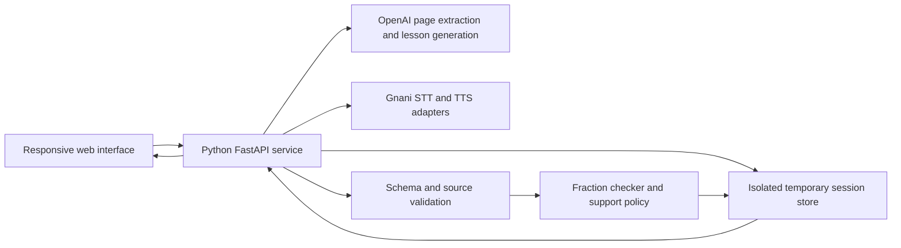

# PageAble

## Product requirements document

**Tagline:** A different way into every lesson.

**Pitch:** Turn a textbook into an interactive learning studio. Ask a question aloud and change the visual on the page. Teach the idea back in your own words. Explore why an answer fails, then test your understanding on a new problem. Every explanation stays connected to the source, and every interaction works through an accessible alternative.

| Item | Decision |
| --- | --- |
| Version | 4.0 — subject-general textbook understanding with validated optional diagrams |
| Prepared | November 4, 2026, IST |
| Event | Neural Storm 2026 |
| Track | Human Impact — HI-03: Adaptive Learning for Students with Disabilities |
| Primary demonstration | Understanding fractions: equal parts, numerator and denominator, equivalence |
| AI components | Python-based OpenAI page understanding and lesson generation; Gnani.ai speech recognition and narration |
| Interface | Responsive web application with an editorial visual identity and an accessible lesson workspace |
| User-confirmed resources | OpenAI API access and Gnani.ai API credits; balances, scopes, and quotas remain unverified |
| Current deliverable | PRD only. This document does not claim that the application or any model evaluation has been built. |

### Scope correction — subject-general textbook support

This revision supersedes every fractions-only scope statement below. Readable textbook pages from any educational subject can generate source-linked explanations, narration, contextual answers, concept-specific teach-back, and multiple-choice practice. Lesson titles, concepts, learning goals, rubrics, questions, and answer keys derive from the confirmed source. Exact diagrams and numerical counterexamples remain optional validated capabilities; a diagram is not fabricated for an unsupported subject. The first broader verification set covers photosynthesis, history, geography, and algebra. English is the current uploaded-lesson language. Source quotes and answer-key structure are validated, but generated teaching correctness still requires review and evaluation.

### Product direction and release contract

PageAble is an ambitious accessible learning product with eight connected experiences. The three signature capabilities establish its identity; source upload, accessible modes, contextual questions, bilingual explanations, and a useful recap make it complete. The first demonstration proves this experience on a bounded topic.

**Three signature capabilities define the experience:**

1. **Talk to the lesson:** a voice instruction changes a checked interactive visual while the explanation stays synchronized.
2. **Teach it back:** the learner explains an idea, then receives evidence-linked feedback on the concept rather than their accent or speaking confidence.
3. **See why an answer fails:** a precise visual counterexample addresses a confirmed mistake before the learner tries a fresh problem.

**The complete release has eight experiences:**

| Experience | Purpose | Role |
| --- | --- | --- |
| 1. Page-to-lesson | Upload, inspect extraction, and create a source-linked lesson | Entry into the product |
| 2. Talk to the lesson | Change an exact interactive visual through voice or text | Signature capability |
| 3. Teach it back | Explain the concept and inspect feedback tied to your own words | Signature capability |
| 4. See why an answer fails | Explore a checked counterexample and attempt a fresh question | Signature capability |
| 5. Read, Focus, and Listen | Change presentation while preserving place and context | Accessible learning foundation |
| 6. Highlight & Ask | Select a passage and ask a contextual question by text or voice | In-context understanding |
| 7. Bilingual explanations | Keep the source visible while using one reviewed Indian explanation language | Language access |
| 8. Learning recap | Inspect actual attempts, support, and a suggested next exercise | Evidence and continuity |

Readable text, keyboard operation, narration controls, source inspection, and reduced motion apply across all eight. They are shared foundations, not separate product modules.

**UI quality is a release requirement.** Screen composition, image assets, typography, transitions, concept animation, responsive layouts, and failure states are built alongside functionality. Both the behavior gate and the visual gate must pass. The user has explicitly prioritized the interface as the strongest part of the presentation.

Broader school-platform features are outside this release. Detailed contracts for the signature capabilities and contextual questions follow in section 4A; the visual implementation brief is in sections 9–10.

## 1. Product thesis

A learner may understand a concept when it is spoken, illustrated, or broken into manageable steps, yet encounter the same material as a dense textbook page. Teachers rarely have time to prepare multiple accessible versions of every lesson.

PageAble converts the learner's own material into an interactive, source-linked learning experience. The learner controls presentation, language, pace, and input method. Spoken requests, visual actions, explanations, and practice responses influence what happens next.

The central product loop is:

**Bring material → explore by voice, text, or interaction → explain your reasoning → inspect targeted feedback → transfer the idea to a new problem → review the evidence.**

UNICEF's accessible textbook initiative provides useful grounding: it describes flexible formats such as narration, simplified text, and image descriptions, and recommends involving learners, teachers, and persons with disabilities in design and testing. This supports the problem choice; it does not establish that PageAble improves learning. [Source: UNICEF](https://www.unicef.org/innocenti/documents/accessible-textbooks-every-child)

### Product principles

1. **Keep the learner in control.** Offer preferences without requiring a diagnosis or assigning a learning-style label.
2. **Preserve the concept.** Simplify language and presentation without silently removing mathematical meaning.
3. **Make the source inspectable.** Readers can see which original passage supports an explanation.
4. **Change the support deliberately.** Use the observed answer and a supported misconception category to select a different explanation.
5. **Treat voice as an input and output choice.** Every essential action also works without speech or hearing.
6. **Make the design memorable through craft.** Typography, composition, imagery, and concept animation should carry the identity.
7. **Show evidence honestly.** Distinguish practice results, estimated support needs, and actual learning outcomes.

## 2. Goals, boundaries, and positioning

### Primary goals

- A first-time visitor can complete a useful learning loop without creating an account.
- A learner can transform a supported page into short explanations, narration, and checked practice.
- A learner can control a supported visual with a spoken or typed request and see a correct, inspectable state change.
- A learner can explain a concept in their own words and receive feedback that quotes their confirmed explanation and the lesson evidence.
- A learner can ask about a selected passage and receive a concise explanation anchored to that selection.
- A learner can use a reviewed second explanation language while inspecting the unchanged source.
- A wrong answer produces a relevant change in support that is visible in the demo.
- A teacher can inspect the source, attempts, hints, and the reason for the next exercise.
- Judges can verify real Python AI calls, operational speech integration, and measured evaluation results.

The architecture can later expand through validated subject modules. Additional curriculum, accounts, class administration, and publishing are outside the current release. Each future module needs its own content schema, accepted interactions, validators, and teaching rubric.

### What distinguishes the experience

| Product decision | Result for the learner | Evidence available to judges |
| --- | --- | --- |
| The uploaded page anchors the lesson | The student works on the material already assigned | Original passage beside generated explanation |
| Multiple representations share a concept ID | Reading, narration, and interactive examples stay connected | Same objective and source across views |
| A targeted support loop follows an error | The next interaction addresses a specific difficulty | Attempt → category → selected explanation → fresh question |
| Numeric answers use deterministic checking | Fraction equivalence can be checked consistently | Test cases and exact answer normalization |
| Speech uses explicit turns | The student can speak without a persistent open microphone | Visible recording, editable transcript, confirmed submission |
| Teacher evidence is assembled from session events | Progress claims can be inspected | Actual counts, question IDs, timestamps, source links |
| Spoken instructions manipulate the lesson | The learner can ask to compare or change an example directly | Recognized intent, validated visual state, and synchronized description |
| The learner teaches the concept back | Understanding can be expressed through explanation as well as a quiz answer | Confirmed transcript, rubric items, source evidence, and a follow-up task |
| A checked counterexample demonstrates an error | The learner can inspect why their reasoning fails | Original attempt, clarified reasoning, rendered example, and transfer question |

This is a differentiation hypothesis for the submission, not a claim that these features are unprecedented.

### Explicit boundaries

- The first demonstration validates the signature capabilities on introductory fractions, roughly grades 5–7. The product roadmap extends beyond that topic through explicit subject modules.
- It is an educational support prototype, not a disability assessment or treatment product.
- It does not infer dyslexia, ADHD, low vision, dyscalculia, intelligence, or emotional state from behavior.
- It does not claim to accommodate every disability. It provides specific, testable controls.
- It does not cover handwriting, arbitrary equations, long textbooks, or every school subject in the first release.
- It does not train a foundation model. Pretrained AI is a meaningful component, and its use is disclosed.
- It does not generate classroom outcome statistics, testimonials, school partnerships, or usage numbers.

## 3. Users and jobs to be done

Personas below are fictional design tools, not research findings.

| Persona | Situation | Job to be done | Success signal |
| --- | --- | --- | --- |
| Learner who finds dense text difficult | An assigned paragraph feels overwhelming | Show me one manageable step and let me listen | Completes a step without navigating a dense page |
| Learner who needs larger text or assistive technology | Small print and visual layouts create barriers | Give me readable controls and meaningful structure | Completes the loop with keyboard or screen reader |
| Multilingual learner | The source is English; explanations are easier in another language | Explain the concept in my selected language while preserving the original | Can inspect both source and explanation |
| Teacher or caregiver | Several learners need different support | Show what happened and what might help next | Sees attempts, hints, and a useful next practice recommendation |
| Judge | Limited time to evaluate the project | Let me experience the transformation and inspect the AI | Completes the demo and opens the evaluation evidence |

For the public hackathon demonstration, use fictional session names and team-authored materials. Any testing with children requires a separately prepared, appropriate consent and supervision process; it is not assumed in the hackathon plan.

## 4. Scope and priority contract

The eight experiences above form one release. The rows below specify the implementation requirements within those experiences. **P0:** Required within the supported topic. **Gated P0:** Required for the intended release, with explicit validation before enablement. **Deferred:** Outside the hackathon build.

| ID | Feature | Priority | Scope |
| --- | --- | --- | --- |
| F01 | Upload a page or open a sample | P0 | One JPG/PNG image, plus pasted text fallback |
| F02 | Extraction review and lesson outline | P0 | Editable extracted text; short, source-linked concept blocks |
| F03 | Learning preferences | P0 | Text size, spacing, contrast, reduced motion, explanation language |
| F04 | Read, Focus, and Listen | P0 | One shared lesson model; chunk-level narration highlighting |
| F05 | Interactive fraction visual | P0 | Numerically checked fraction bars and number lines with equivalent text and keyboard controls |
| F06 | Grounded micro-practice | P0 | Checked fraction questions, hints, and meaningful feedback |
| F07 | “Explain it another way” | P0 | Targeted support followed by a fresh question on the same concept |
| F08 | Gnani voice input and output | P0 | Short push-to-talk answers; narration; transcript confirmation |
| F09 | Session learning summary | P0 | Actual attempts, support events, and source references |
| F10 | Complete visual system and responsive states | P0 | Home, studio, practice, summary, and error/empty/loading states |
| F11 | Evaluation and submission evidence | P0 | Reproducible evaluation file, README, screenshots, and demo script |
| F12 | Bilingual explanations | Gated P0 | English and one reviewed Indian language; enable only after content, font, STT, and TTS checks |
| F19 | Talk to the lesson | P0 | Six supported intents controlling a fraction scene through voice or text |
| F20 | Teach it back | P0 | One reviewed concept rubric, transcript confirmation, evidence-linked feedback, fresh follow-up |
| F21 | See why an answer fails | P0 | One confirmed fraction-error pathway with a checked visual counterexample |
| F27 | Highlight & Ask | P0 | Select a source/lesson passage and receive a concise source-linked answer through text or confirmed speech |

Deferred as a single future backlog: class accounts, teacher batch publishing, portable access passports, concept graphs, offline synchronization, long PDFs, additional subjects, full duplex conversation, and a fitted student knowledge model. They require no active navigation item, placeholder, data model, or implementation work in this release. Their former detailed requirements are removed to keep the active PRD focused.

Scope rule: never ship a decorative control that pretends to change a lesson or a progress screen populated with invented student activity. Unavailable features are omitted or clearly marked as previews.

## 4A. Signature capabilities and contextual questions

### F19 — Talk to the lesson

**Learner promise:** “Show two quarters next to one half,” “Make the pieces smaller,” or “Explain this part again” changes the visible lesson rather than merely returning another paragraph.

The learner selects a concept or passage, then speaks or types a bounded instruction. Gnani transcribes speech. OpenAI maps the confirmed text to a supported intent and parameters. Python checks the command against the active scene, and application components render the new state. Narration describes the accepted state only after validation.

**First demonstrated intents:**

| Intent | Example request | Visible result |
| --- | --- | --- |
| Set fraction | “Show three quarters” | Update numerator, denominator, accessible description, and bar |
| Compare | “Compare one half and two quarters” | Show two labeled bars with exact proportions |
| Subdivide | “Split each half into two equal parts” | Animate halves becoming quarters without changing the shaded amount |
| Explain selection | “Why are these equal?” | Give a source-linked explanation of the selected comparison |
| Change representation | “Show that on a number line” | Switch between the checked fraction-bar and number-line renderers |
| Control pacing | “Pause,” “repeat this,” or “one step at a time” | Update playback or the active step without losing context |

**Acceptance criteria**

- Text entry and explicit controls can perform every supported voice action.
- Selection is semantic, using concept/block IDs; pointing at an arbitrary pixel is a later capability.
- Unsupported commands receive an explanation and a nearby supported choice.
- Ambiguous values require clarification; no silent reinterpretation of “two over three” into an unrelated expression.
- Commands return typed data such as `intent`, `parameters`, `scene_id`, and `source_version`; the model never supplies executable scene code.
- Narration, visible math, alt description, and scene state reference the same validated values.
- The learner can undo the last scene change. Out-of-order voice responses cannot mutate a newer scene version.
- A session-visible action history shows the request and resulting change. It contains no private operational prompt or credentials.

**Demo-worthy moment:** The learner asks for two equivalent fractions and watches the same shaded quantity become differently divided equal parts while hearing the explanation.

### F20 — Teach it back

**Learner promise:** “Explain it in your own words, and discover which part of the idea needs another example.”

After exploring a concept, the learner can choose **Teach it back**. They explain through a confirmed transcript, typed text, or structured choices. The first rubric covers fraction equivalence:

1. The amounts being compared refer to the same whole.
2. The whole is divided into equal-sized parts within each representation.
3. Equivalent fractions describe the same quantity despite different numbers of parts.

OpenAI maps the learner's explanation to `supported`, `contradicted`, `not_mentioned`, or `unclear` for each rubric item. Each nonempty assessment references the learner's exact confirmed words and the approved lesson evidence. Python validates quote offsets, rubric IDs, and source IDs. A follow-up task checks whether the learner can apply the idea.

**Acceptance criteria**

- The activity is optional. Speech is never mandatory for expressing understanding.
- The learner reviews a transcript before feedback is generated.
- Feedback quotes only words actually present in that confirmed version.
- Silence or an omitted idea is recorded as `not_mentioned`, not a false belief or inability.
- Accent, pronunciation, speaking rate, grammar, and emotional expression do not affect the concept rubric.
- The feedback uses a specific follow-up such as “What needs to stay the same about the whole?” rather than issuing a diagnosis.
- The learner can correct a misunderstood explanation and regenerate feedback.
- The system does not present a numerical understanding score as a validated psychological or academic measure.
- A learner can reject misunderstood feedback and correct the confirmed explanation without the rejected judgment silently influencing subsequent practice.
- Transcripts, rubric judgments, and applied practice are displayed separately so neither fluent speech nor memorized wording substitutes for demonstrated understanding.

**Product hypothesis:** Explaining and applying a concept can reveal gaps that a selected multiple-choice answer misses. This hypothesis needs evaluation; it is not an established outcome of this prototype. Learning-by-teaching is an existing research area, including work on teachable LLMs. [Stanford research listing](https://scale.stanford.edu/ai/repository/teach-ai-how-code-using-large-language-models-teachable-agents-programming-education)

### F21 — See why an answer fails

**Learner promise:** Inspect the reasoning behind an error through an exact visual example, then try a new problem.

The feature first asks the learner to select or explain their reasoning. It uses a checked counterexample only if the mistake fits a supported rule. The opening slice addresses adding fractions by adding both numerators and denominators.

Example: the learner writes `1/2 + 1/2 = 2/4` and confirms that they added the top and bottom numbers. The scene shows one half plus one half covering a whole, then compares that amount with two quarters. Accompanying text explains the mismatch. The learner subsequently solves a different checked item with equal denominators.

**Acceptance criteria**

- A wrong answer alone does not establish the learner's reasoning. Ask a brief clarification when needed.
- Counterexamples and expected quantities are computed by Python, not accepted from a generated image.
- The learner can step forward, back, pause, or use a complete static textual explanation.
- The visual never presents differently sized wholes as directly comparable without explicit explanation.
- The follow-up changes the numbers and retains the same concept; success is labeled supported or independent according to the help actually shown.
- If the error is unsupported, provide a reviewed worked example rather than inventing a causal diagnosis.

### F27 — Highlight & Ask

**Learner promise:** Select the phrase that is confusing and ask about that exact part of the lesson.

Selecting text opens a small contextual action with **Explain this**, **Give an example**, and **Ask a question**. A keyboard-selectable paragraph action provides the same capability without requiring a mouse drag. A confirmed voice transcript or typed question opens a compact explanation sheet beside the selected passage.

**Acceptance criteria**

- Requests include document/lesson version, block ID, and validated selection offsets. A selection from an older lesson version cannot be answered against a newer source silently.
- The active selection is clearly labeled in the response and remains easy to revisit.
- Answers stay concise, typically one short explanation and one checked example, with resolvable source references.
- Selecting a generated analogy identifies it as an example and links back to the source concept.
- Unsupported questions receive an explicit boundary or clarification. Source material cannot instruct the system to perform external actions.
- Math examples pass the same supported validators as practice items.
- The explanation can be narrated through Gnani; the visible text remains available.
- Closing the sheet returns focus and scroll position to the initiating passage.
- The sheet does not turn the main workspace into an endless chat feed; the current question and explanation remain tied to the selection.

### Capability hierarchy

The eight experiences serve one coherent workspace. **Explore**, **Explain**, and **Practice** are the main learning actions. Source evidence, access preferences, language, and the current lesson outline remain reachable without filling the screen with a separate card for every capability.

### Delivery milestones

| Milestone | Result | Exit criterion |
| --- | --- | --- |
| M1 — Designed vertical slice | Final visual foundation and one real voice-controlled fraction scene | Hero, studio, actual imagery, responsive structure, scene motion, and provider integration work together |
| M2 — Complete learning loop | Add teach-back, counterexample, practice, source review, and recap | Real data flows through all three signature capabilities |
| M3 — Complete release | Add contextual questions and the reviewed bilingual path; finish every UI state | The eight experiences pass functional, visual, accessibility, and language gates |
| M4 — Submission evidence | Reproducible checks, live deployment, README, screenshots, and walkthrough | Product claims match observed behavior and the actual build |

Estimate each milestone against the actual remaining time and provider behavior. UI polish is part of each milestone and cannot be postponed wholesale to the end.

## 5. The core journey

### 5.1 Arrival

The visitor sees a human-centered product introduction, a tangible page-to-lesson preview, and two clear actions: **Try a sample lesson** and **Upload a page**.

The sample path opens a team-authored fractions page immediately. The upload path states accepted formats, the size limit, and that the page is sent to an AI provider for processing.

### 5.2 Bring a page

1. Select or drop a JPG/PNG, maximum 8 MB and one page.
2. Validate file signature, dimensions, and decoding; normalize orientation and strip image metadata.
3. Show the image and begin extraction with an honest phase indicator.
4. Present extracted text for review before building the lesson.
5. Let the user correct a misread number or symbol and confirm.

Camera capture is progressive enhancement on supported devices. File upload and pasted text remain complete alternatives.

### 5.3 Choose preferences

Ask: **“How would you like to work through this?”**

Offer plain-language controls such as **Larger text**, **More spacing**, **One step at a time**, **Read aloud**, and **Reduce motion**. Preferences are independent and reversible. Do not group learners into clinical categories or promise that a font treats a condition.

### 5.4 Learn and explore

The studio displays a lesson title, a compact concept outline, one active explanation, and an optional source drawer. The learner can switch representation without losing position.

For fractions, the learner can change the numerator and denominator on an accessible fraction bar. Visible math, a text description, and optional narration update together.

The learner can also use **Talk to the lesson** to change a supported scene. A comparison or subdivision request changes the validated visual, updates its semantic description, and offers a concise explanation. The same actions are available through text and buttons.

### 5.5 Try and adapt

The learner answers a question by selecting, typing, or speaking. Numeric grading runs in Python. If an error matches a supported category, PageAble offers a targeted hint or different representation, then a new problem with changed values.

The learner can always choose **Explain it another way** without first failing a question.

They can choose **Teach it back** to explain the concept through speech, typing, or structured choices. Feedback identifies evidence in the confirmed explanation, asks about missing ideas, and proposes a fresh application question. If the learner confirms a supported mistake in reasoning, **See why an answer fails** provides a checked visual counterexample.

### 5.6 Review

The summary states what was attempted and which support was used. It can say **“Answered 2 of 3 equivalent-fraction questions correctly; used a visual hint once.”** It cannot say **“Cured your difficulty”** or **“Mastery: 97%”** without a validated basis.

## 6. Functional requirements and acceptance criteria

### F01–F02: Page understanding and grounded lesson building

**Behavior**

- OpenAI receives the page image through the Python service and returns a structured extraction.
- The server assigns stable source-block IDs after normalization. Generated content references those IDs.
- The user confirms or edits extracted content before generation. This confirmation is not described as expert verification.
- The generation response contains a title, objectives, concept blocks, explanations, source references, and supported practice specifications.
- Unsupported topics receive a helpful boundary message and the sample lesson option.

**Acceptance criteria**

- The original image remains available through a labeled source control.
- Changing an extracted fraction invalidates dependent content and requires regeneration.
- Every explanatory block has a resolvable source reference or an explicit **Illustrative example** label tied to a supported concept.
- A source citation proves traceability, not truth. The product never equates a valid link with a verified explanation.
- Low-confidence or ambiguous extraction is shown as **Needs a check**; no uncalibrated numeric confidence badge is displayed.
- Damaged files, unclear images, schema errors, refusals, and unsupported subjects have distinct recovery paths.
- Uploaded page content is treated as untrusted data, including any embedded instructions addressed to the model.

### F03–F04: Accessible reading, focus, and narration

**Read:** Concise semantic content with a clear heading hierarchy, definitions, and optional source references.

**Focus:** One block at a time with a visible position indicator. Previous/Next controls preserve the learner's place. Large text must not create nested scroll traps.

**Listen:** Gnani narration of the exact approved explanation text. Controls include play/pause, replay block, previous/next block, mute, and playback speed where supported by the browser.

**Acceptance criteria**

- Switching modes preserves concept, answer state, and source version.
- Audio begins only after a user action. No narration or microphone capture starts on page load.
- Narration is generated in small semantic chunks. Highlight the active chunk from actual playback events.
- Do not promise word-level alignment unless timestamps or an evaluated alignment step are implemented.
- Text edits cancel outdated audio; cache keys include content, language, voice, and version.
- The transcript is always visible or one action away. Audio failure leaves the lesson readable.
- System reduced-motion preferences are honored; a visible preference can also reduce motion.

### F05: Interactive visual explanation

**First-demonstration visuals:** Fraction bars and a checked number line, supporting the voice-controlled representation change in F19. Additional diagram styles are optional after these pass the behavior and visual gates.

**Acceptance criteria**

- Numerator and denominator are validated integers with a nonzero denominator and bounded supported ranges.
- Visual proportions are rendered from numeric data through application code.
- The visual has an equivalent description, for example **“Three of four equal parts are shaded: three quarters.”**
- Increment/decrement buttons and numeric inputs provide alternatives to pointer dragging.
- Labels, patterns, outlines, and text convey meaning alongside color.
- Concept animations can be paused, replayed, or reduced to a static final state.
- Generated raster images are never the authoritative representation of fraction counts, equations, charts, or answer-bearing diagrams.

### F06–F07: Practice and the adaptive support loop

Supported concept IDs:

- `equal_parts`
- `numerator_denominator`
- `fraction_equivalence`

Supported difficulty/support states:

- `starting`: no usable evidence yet.
- `practicing`: one or more recorded attempts.
- `needs_another_example`: an observed error or explicit help request.
- `ready_for_next_step`: two recent independent correct responses on varied items.

These are transparent session rules, not probabilities of mastery or disability classifications.

**Adaptation decision order**

1. Respect an explicit learner choice to change representation.
2. Score the answer with a deterministic checker where applicable.
3. Match known fraction errors using explicit rules; an LLM may suggest a supported category with evidence when a rule does not apply.
4. If uncertain, ask a clarifying question or offer a neutral worked example.
5. Select a checked representation and a new question on the same concept.
6. Record what changed and why.

**Example**

- Question: which fraction is equivalent to one half?
- Learner selects two thirds.
- The system does not diagnose the learner or assume the reason from one response.
- It asks or offers: **“Let's compare the equal parts. Would a picture help?”**
- A fraction bar shows one half and two quarters with accompanying text.
- The learner then attempts a fresh item, such as matching three sixths.

**Acceptance criteria**

- Every generated numeric question is validated before it is shown.
- Equivalent values such as `1/2` and `2/4` are normalized correctly.
- No arbitrary expression evaluation or model-produced executable code is used to grade answers.
- The answer key is not included in the learner-facing question payload before submission.
- Hint-supported success is recorded separately from independent success.
- Repeated submissions use an idempotency key and do not duplicate attempts.
- Feedback explains the relevant concept without shaming, ranking, or fabricated encouragement.
- The support decision log names the observed event, policy rule, and selected representation.
- The next question changes values or context; it does not merely repeat a revealed answer.

### F08: Gnani speech input and output

**Division of responsibility:** Gnani handles speech recognition and speech synthesis. OpenAI handles lesson reasoning, image understanding, and text generation. No general-purpose Gnani text-generation capability is assumed.

**Voice input workflow**

1. The learner activates **Speak your answer** and grants microphone access if needed.
2. The interface explicitly shows recording state and a countdown; stop at 25 seconds.
3. Audio is sent to the Python service, then Gnani STT.
4. An editable transcript appears. The learner confirms or corrects it before answer submission.
5. Ambiguous spoken fractions receive confirmation, for example **“Did you mean one half, written 1/2?”**

**Acceptance criteria**

- Use start/stop buttons with keyboard support; holding a button is never required.
- Cancel discards the clip. The microphone indicator ends when recording ends.
- Pause narration before recording to avoid transcribing the application's own audio.
- The browser produces a supported audio format or the backend converts it. Browser WebM must not simply be sent with a WAV filename.
- Silence, permission denial, interrupted upload, provider errors, and unrecognized speech have separate recovery messages.
- Transcription errors never silently become scored learner mistakes.
- Narration carries a clear **AI-generated voice** disclosure.
- Select a documented Gnani voice compatible with the chosen TTS model and language; verify account access during implementation.
- Keep one provider call active at a time per speech queue unless the account demonstrably permits more.

Gnani documents bounded REST transcription and separate voice catalogs by model. The 25-second product cap stays below its documented 30-second REST limit. Account quotas must still be checked. [STT limits](https://docs.gnani.ai/api/STT/limits), [voice catalog](https://docs.gnani.ai/api/TTS/available-voices)

### F09: Session evidence for teachers and caregivers

This is an alternate view of the same isolated demo session, not an unauthenticated public class dashboard.

Show:

- Concepts attempted and actual question counts.
- Independent versus supported correct answers.
- Explicit help requests and representations selected.
- Example answers and the corresponding feedback.
- Source-linked explanation blocks.
- A next-practice suggestion with its evidence.

**Acceptance criteria**

- All statistics are computed server-side from recorded events.
- Counts use visible denominators and time windows.
- Fewer than two attempts is labeled **Not enough practice to summarize this concept**.
- No inferred diagnosis, emotion, ability ranking, or permanent learning-style profile appears.
- A session can be reset or deleted; summaries then disappear.
- Other visitors cannot inspect a session by guessing its URL or document ID.

## 7. Language strategy

The intended release includes **English and one reviewed Indian explanation language**. English is implemented first. Telugu is the proposed local-context choice; Hindi is the alternative if that is the language the team can review reliably. Selection and bilingual review are release dependencies, not permission to publish unreviewed translations.

Language switching preserves the source, selected concept, question values, scene state, and submitted answers. Replace generated wording and narration as an atomic version change; never show translated text alongside audio for an earlier version. Pause narration before changing language. Keep key terms available in the original wording with a brief reviewed explanation. Interface labels can remain English in the first release if that boundary is stated clearly.

If no qualified review is available, ship an honestly labeled English-only build and record the bilingual requirement as incomplete. Never display a working-looking language option that produces unverified content or unavailable audio.

Source language, explanation language, and speech-recognition language are separate fields. English source material can remain visible while an explanation uses another language.

For each enabled language, test displayed script, font coverage, voice pronunciation of fractions, transcript normalization, and preservation of numeric meaning. Verify provider support and account access independently. Do not advertise ten working product languages merely because a provider lists ten languages.

## 8. Information architecture and screen specifications

| Screen | Primary job | Main action | Secondary action |
| --- | --- | --- | --- |
| Home | Understand the product and enter a real lesson | Try a sample lesson | Upload a page |
| Import and review | Confirm what the page says | Build my lesson | Edit extracted text |
| Learning studio | Understand one concept | Try a question | Listen / change representation / view source |
| Practice | Attempt and receive support | Check answer | Speak answer / get a hint |
| Session summary | Inspect what happened | Continue practicing | View evidence / delete session |
| About and evaluation | Understand methods and limitations | View evaluation | Open repository |

### Home: the first visual impression

- A restrained wordmark built around a page-fold/book-spread motif.
- An oversized editorial headline: **“Your textbook. Your way in.”**
- Short supporting copy that describes the actual workflow.
- A large, art-directed composition pairing an authentic page preview with a finished accessible lesson preview.
- One human photograph of a learning setting, paired with custom illustrated subject artwork.
- A small interactive before/after section that can also be operated by keyboard.
- A three-step explanation: **Bring a page. Find your format. Build understanding.**
- An honest project note: **A Neural Storm prototype for accessible learning.**

### Studio: the primary product surface

At desktop widths, use three regions with an intentional hierarchy:

```text
PageAble       Fractions / Equal parts          Preferences   End session
------------------------------------------------------------------------
Lesson outline       Main learning canvas             Optional source
1. Equal parts       Concept title                    Original passage
2. Fraction names    Short explanation                Page preview
3. Equivalence       Fraction bar                    Source reference
                     Read / Focus / Listen
                     [Explain another way] [Try it]
------------------------------------------------------------------------
Playback controls or recording controls, only when relevant
```

The source region is collapsible so it never compresses the lesson into a narrow column. On mobile, use a single column with an outline drawer and a source sheet. Preserve the same DOM reading order across breakpoints.

The main canvas has three purposeful destinations: **Explore**, **Explain**, and **Practice**. Explore contains the interactive scene, Read/Focus/Listen controls, and the voice/text instruction strip. Explain contains the teach-back prompt, confirmed transcript, and rubric evidence. Practice contains questions, counterexamples, and new applications. The source drawer, language, and access controls persist across all three. Highlight & Ask is contextual and never adds another permanent navigation tab.

The teach-back view uses a clear editorial split: the learner's words on one side and concept evidence on the other. Mark quoted passages with underlines and text labels rather than a red/green heatmap of the learner. A counterexample opens in the active scene with a step control, keeping the original answer visible. A compact lesson outline provides concept navigation without a separate graph screen.

### Practice: a calm exercise surface

- One question at a time, with its concept name visible.
- A generous answer area with clear typed, selected, and spoken input options.
- Inline feedback that preserves the question and learner response.
- A support panel expands beside or below the question when needed.
- A visible next step replaces an endless conversation history.

### Summary: a learning journal

Use readable evidence rows and concise narrative copy. A chart is optional; it must add information beyond a count. Place the learner's actual work ahead of analytics decoration.

## 9. Visual direction: a crafted learning publication

**Design character:** Warm, intelligent, tactile, optimistic, and appropriate for both learners and teachers. Think of a carefully designed learning magazine combined with an interactive workbook.

### Art direction

- Paper-toned backgrounds with generous negative space.
- Dark ink typography and one confident accent color.
- Large editorial headlines paired with exceptionally readable lesson text.
- Slightly asymmetric compositions on the home page, consistent alignment inside the lesson.
- Hand-cut paper illustrations, restrained line drawings, page tabs, and meaningful photographic crops.
- Quiet borders and deliberate layering instead of heavy shadows everywhere.

### Proposed design tokens

| Token | Value | Use |
| --- | --- | --- |
| Paper | `#F7F4ED` | Primary background |
| Surface | `#FFFFFF` | Reading and exercise surfaces |
| Ink | `#182B29` | Body text and strong headings |
| Forest | `#245B4B` | Primary actions and active states |
| Terracotta | `#C96A49` | Decorative emphasis; text use requires contrast verification |
| Butter | `#F2D885` | Illustration fills and gentle highlights |
| Muted text | `#53635D` | Secondary copy, subject to contrast checks |
| Divider | `#DCDDD3` | Nonessential separators |

All color pairings must be tested in implementation. Decorative colors do not automatically qualify for text, controls, or focus indicators.

### Typography

- Editorial headings: a self-hosted, licensed serif such as **Lora**.
- Interface and lesson text: a self-hosted, licensed sans serif such as **Atkinson Hyperlegible**, with system fallbacks.
- Hindi/Telugu text: an appropriate self-hosted Noto family after language QA.
- Default lesson text: 20 px equivalent, adjustable from 18–30 px.
- Reading line height: approximately 1.6–1.8; comfortable line length around 55–70 characters where space permits.
- Home headline: approximately 64–80 px desktop and 38–46 px mobile, with fluid sizing.
- Never put long lesson paragraphs in all caps, justified text, or low-contrast decorative type.

Font choices are design candidates, not therapeutic claims. Verify licenses and script coverage before bundling.

### Components

Use a compact set: page shell, editorial header, primary/secondary buttons, preference controls, source drawer, lesson block, playback bar, recording panel, question surface, inline feedback, evidence row, and accessible modal.

Buttons should have an intentional rectangular silhouette with moderate rounding. Use small-radius surfaces and occasional pill-shaped mode controls. A shared grid and spacing scale should create cohesion.

### Imagery requirements

| Asset | Purpose | Treatment |
| --- | --- | --- |
| Learning-setting photograph | Give the home page a human context | Natural light, genuine activity, dignified representation; licensed and attributed as required |
| Fractions subject artwork | Establish a recognizable lesson identity | Custom paper-cut shapes and everyday objects |
| Sample worksheet image | Make the transformation tangible | Team-authored, legible, and free of personal information |
| Product screenshot | Explain what the app does | Captured from the actual working interface |
| Mathematical visuals | Teach and support answers | Data-driven SVG/HTML with semantic equivalents |

Provide an asset manifest containing source, license, author when applicable, intended placement, alt text, and decorative/content status. Generated decorative art is labeled in project documentation and never presented as a photograph of actual users or a real school pilot.

Use responsive modern image formats, explicit dimensions, and lazy loading below the fold. Keep meaningful images legible on narrow screens. Essential concepts must not depend on an image alone.

### Interface exclusions

Avoid default purple/blue gradients, glowing AI orbs, sparkle badges on every control, repeated glass panels, generic dashboard statistic tiles, and a chat composer as the main screen. Provider names and model settings belong in project information or diagnostics, not in the learner's primary navigation.

These exclusions apply to product art direction. The AI-generated voice disclosure and clear processing explanations remain visible where relevant.

## 9A. UI implementation brief — a primary release requirement

### Visual hierarchy and quality bar

The interface should look authored from the first screen. Its identity comes from the combination of an editorial page composition, tactile subject illustrations, a precise interactive canvas, and a recognizable set of transitions. Default component-library styling is insufficient as the final treatment.

Use two levels of expression:

- **Home and entry:** expressive scale, photographic composition, custom artwork, a strong before/after demonstration, and a clear invitation to try the product.
- **Learning workspace:** the same type, color, and material language with quieter composition, readable content, clear state, and user-controlled concept animation.

Design every visible view for its real content. Avoid a polished home page followed by generic upload forms and an unfinished studio. The studio is the most important sustained product surface.

### Screen 1 — Editorial home

At a 1440 px viewport, use a maximum content width around 1280 px, approximately 64–80 px side breathing room, and a deliberate 12-column composition. These are starting constraints; responsive content fit takes precedence over fixed coordinates.

**Header:** compact PageAble wordmark at left; How it works and Accessibility links; a clear Try a lesson action. Keep the header around 72 px high and avoid a second competing navigation row.

**Hero:** use a roughly 5/7 split between headline copy and the visual composition. Set “Your textbook. Your way in.” in the editorial typeface, with a restrained hand-drawn underline or paper highlight on one meaningful phrase. Supporting copy stays within two short paragraphs. Show a primary **Try a sample lesson** action and a secondary **Upload your page** action.

The hero visual combines a legible worksheet crop, a real product preview, and custom fraction artwork. A warm learning-setting photo appears as one purposeful crop within or adjacent to the composition, with clear visual separation from screenshots. The artwork may use a slight static perspective or paper overlap; the text readers must use remains flat and readable.

**Below the hero:** one interactive page-to-lesson demonstration, then a compact three-part explanation of the signature capabilities. Use a photographic or illustrated editorial band and a final call to try the lesson. Avoid a long grid giving equal prominence to every supporting control.

No fabricated school logos, stars, testimonials, student counts, or awards. Demonstration captions distinguish real captured product output from illustrative artwork.

### Screen 2 — Bring a page and review it

Build an attractive working table: the source image on one side, readable extracted content on the other. The upload target uses an illustrated page motif and explicit file guidance. After upload, retain the image in place while the actual processing phase changes nearby.

During review, uncertain values receive a labeled inline treatment. The **Build my lesson** action sits after the review content, with a short explanation of what happens next. On mobile, show the preview above editable text; the primary action remains reachable without covering the focused field.

The empty state includes the actual sample worksheet thumbnail and a working sample action. Error messages sit beside the affected operation and offer a concrete recovery action.

### Screen 3 — Explore workspace

For a wide desktop layout, start with a 64 px app header, approximately 208 px lesson outline, a flexible central canvas, and an optional source panel around 304 px. The canvas needs comfortable room for both a comparison diagram and its explanation. Collapse the source panel before the canvas becomes cramped; do not preserve three columns at all widths.

The central canvas contains:

1. Small concept label and a strong, readable title.
2. A short explanation with Read/Focus/Listen presentation controls.
3. A generous diagram stage with labeled exact quantities.
4. An instruction strip: **“Ask to change the example…”**, a text input, and a clearly labeled microphone action.
5. Useful sample commands that execute real supported actions.
6. One primary next action, such as **Teach it back** or **Try a question**.

A successful voice command highlights only the values or region that changed. Scene motion and narration follow the actual validated state. Keep the source drawer and accessibility preferences available without crowding this working area.

### Screen 4 — Teach it back

Use a generous prompt followed by a recording or text surface. After transcript confirmation, place the learner's words alongside concise concept feedback. Use underlining, quotation marks, connectors, and evidence labels to associate a phrase with its feedback.

Avoid a dashboard of scores. A clear state such as **“You explained the equal quantity. Let's check the same-whole idea.”** is more useful than an unsupported understanding percentage. The next application question appears as a deliberate next step, with the original explanation still inspectable.

### Screen 5 — Practice and counterexample

Use a clean exercise sheet with a large question, a comfortable answer region, and a primary Check answer action. When support is needed, preserve the original attempt in a small adjacent reference while a visual stage explains the concept. The scene has labeled Previous/Next steps and a static explanation alternative.

On successful independent application, use a brief visual acknowledgment, a specific statement about the completed question, and a next action. The interface should not resemble a competitive game leaderboard or a punitive error screen.

### Screen 6 — Learning recap

Present a short learning journal: concepts attempted, exact correct/attempted counts, hints or visual support used, and one evidence-backed next practice recommendation. Show a small strip of the actual lesson artwork and an inspectable example of the learner's work. Keep Continue practicing and Delete session easy to find.

The caregiver/teacher evidence view is part of this session recap, not a separate school administration product.

### Contextual sheets and controls

- **Highlight & Ask:** anchor the action near the selection when space permits; open a side sheet on desktop and a bottom sheet on mobile. Preserve the selected passage above the answer.
- **Preferences:** a short, labeled set of controls with a live text preview. Apply readability changes immediately and visibly.
- **Language:** use names in their own scripts where appropriate; show an enabled language only after review. Changing it preserves the concept and pauses old narration.
- **Source:** show the original image and exact cited passage without making generated bounding-box precision claims.
- **Voice:** show recording, transcribing, confirmation, playback, and failure as distinct states. The microphone is a tool within the lesson, not a floating decorative orb.

### Responsive behavior

| Viewport | Required composition |
| --- | --- |
| Wide desktop, about 1280 px and above | Outline + generous canvas; source panel only when enough room remains |
| Tablet and compact desktop | Canvas first; outline/source become drawers; teach-back columns can stack |
| Mobile, about 390 px | Single-column content, compact header, bottom sheets, full-width exercise actions |
| Narrow check, 320 px | No clipped controls or page-level horizontal overflow; representations reflow or use an explicitly labeled local viewport |

Respect safe-area insets. Persistent playback/voice controls must reserve layout space and never cover answers, source references, the software keyboard, or navigation. A focused field scrolls into view without a competing automatic animation.

### Asset requirements for visual sign-off

At minimum, deliver one finished subject illustration, one properly sourced learning-setting photograph, one legible team-authored source-page image, and actual product imagery for the before/after composition. Reuse this small asset family coherently rather than scattering unrelated stock imagery.

Raster images serve identity and context. Mathematical content remains rendered from checked data. Every content image has a meaningful text alternative; decorative art does not interrupt screen-reader reading order. Missing assets are a release defect, not an acceptable final placeholder.

## 10. Animation and interaction requirements

Motion should communicate a change, explain a concept, or give clear feedback. The learner workspace defaults to calm behavior.

| Interaction | Intended behavior | Typical duration | Reduced-motion alternative |
| --- | --- | --- | --- |
| Home introduction | Small staggered reveal of headline and page composition | 250–450 ms, once | Immediate presentation |
| Page-to-lesson preview | Page sections transition into lesson blocks after user action | 350–600 ms | Side-by-side static comparison |
| Buttons and mode changes | Subtle state response with clear focus | 120–180 ms | Color/border change only |
| Fraction equivalence | Equal regions subdivide to explain equivalence | 400–700 ms, user-triggered | Labeled before/after diagram |
| Help panel | Support explanation expands near the active question | 180–250 ms | Immediate expansion |
| Audio activity | Low-amplitude playback indicator | While audio plays | Static playing label |
| Recording | Clear microphone state and elapsed time | While recording | Static recording label and timer |
| Completion | Brief checkmark and a plain-language result | 200–350 ms | Immediate result |
| Spoken scene instruction | Highlight the affected values, then animate only the accepted state change | 250–600 ms | Updated static scene and a text description |
| Teach-back evidence | Associate a confirmed phrase with its rubric feedback after user selection | 150–220 ms | Static quotation and labeled evidence row |
| Counterexample | Step through exact quantities and preserve the learner's original answer beside them | User-controlled steps | Complete static explanation |

Additional requirements:

- No parallax, autoplay video, constant floating objects, forced typewriter text, flashing, or confetti inside lessons.
- Focus must not move unexpectedly when animations finish.
- Recorded audio amplitude may drive a waveform; an animated waveform must not falsely imply microphone activity.
- Loading phases reflect actual server states. Do not display fabricated completion percentages.
- Use CSS transforms and opacity for simple transitions. Introduce an animation library only if a specific interaction justifies it.
- Motion preferences persist locally and respect the operating system by default.

## 10A. Signature motion choreography

Animation is a designed part of the product. Four sequences receive particular attention; each is interruptible, follows real application state, and has an equivalent static presentation.

### A. A page becomes a lesson

After successful source confirmation, retain the source thumbnail as a visual anchor. Once generation is actually ready, transition its approved content into the first lesson block and reveal the diagram stage. A short shared-element movement or crossfade creates continuity. While the provider is still processing, show the actual phase and keep the source visible; do not play a completed transformation early.

Budget approximately 450–650 ms for the final transition. Avoid simulating individual words flying from the page or moving the entire viewport. In reduced-motion mode, replace the transition with an immediate view change and a clear lesson-ready announcement.

### B. Voice changes the visual

1. Recording shows an authentic microphone indicator and timer.
2. Transcription resolves into editable text; nothing changes before confirmation.
3. While interpretation runs, the current diagram stays usable and unchanged.
4. On a validated command, briefly emphasize the affected values and animate the geometric change over roughly 350–650 ms.
5. Update the accessible description immediately with the committed state; start requested narration only for that state.

For equivalence, split equal regions while preserving the shaded amount. For a number line, update labeled tick positions from exact values. A brief visual connection between the confirmed command and the changed diagram makes the causal relationship understandable. Do not place unrelated particles, glow trails, or ambient motion around it.

### C. The learner's words become inspectable feedback

After teach-back feedback is ready, reveal the exact quotation and its rubric row together. Selecting a row highlights the corresponding quoted phrase with an underline and a labeled relationship. Keep the text stable; never type out paragraphs letter by letter or move words as the learner reads.

The response can use a 150–220 ms opacity/position transition. Feedback is revealed only after it exists and passes quote/source validation. If it is rejected or corrected, label the previous result as superseded rather than silently replacing the learner's words.

### D. A counterexample explains the mismatch

The learner advances through three visible steps: their confirmed answer, the exact quantities being combined, and the comparison revealing the mismatch. Fractions preserve a common whole and proportional geometry throughout. Each step can take 400–700 ms after user activation, with pause/back controls.

The final scene leads to a fresh problem. Correctness feedback uses a modest check and a specific explanation. Reduced motion presents the same three steps as static labeled diagrams and text.

### Motion engineering rules

- Primary controls remain responsive while a transition runs; cancellation and navigation do not wait for decorative motion.
- Rapid repeated commands resolve through a controlled queue or explicit cancellation, not overlapping scene animations.
- Animate transforms/opacity where possible. Layout-dependent diagram changes must be bounded to the stage and profiled on a representative device.
- Store application state independently of animation completion callbacks; correctness cannot depend on whether a frame rendered.
- Stopping narration, closing a sheet, changing language, or changing source cancels incompatible pending playback and motion.
- Reserve image and diagram dimensions to prevent jumping layouts. Do not animate content from invisible to visible in a way that leaves keyboard focus on hidden controls.
- Background tabs and reduced-motion settings suspend unnecessary visual work. No constant animation loop runs when the scene is idle.

## 10B. Visual acceptance gate

The following is an internal release standard, not a claim about the hackathon's judging weights. Validate in the actual browser after implementation and record the viewport, device/browser, and limitations.

| Area | Release evidence | Blocking defect |
| --- | --- | --- |
| Visual identity | Home, import, studio, practice, and recap use the same finished type/color/spacing system | A finished hero leads into generic or unstyled product screens |
| Composition | Screenshots at 1440 × 900 and 390 × 844, plus narrow-width review | Main action clipped, cramped canvas, conflicting primary actions, or accidental overflow |
| Imagery | Final asset family, actual source page, product preview, and attribution manifest | Broken images, irrelevant stock fillers, unmarked fake screenshots, or placeholders |
| Motion | Recorded page transition, real voice-to-scene change, teach-back evidence interaction, and counterexample | Animation implies work completed before validation or makes the lesson harder to use |
| States | Empty, ready, loading, error, silence, denied microphone, quota limit, and expired-session views | Blank page, stuck loader, lost confirmed input, or a dead-end error |
| Accessibility | Keyboard, text zoom, screen reader, contrast, and reduced-motion runs | Unreachable action, lost focus, unusable controls, or meaning carried only through motion/color |
| Voice and language | Text, transcript, diagram, and narration stay on the same version | Audio reads stale text or the visual contradicts the confirmed command |
| Performance | Representative-device observation and browser timings | Noticeably frozen interactions, persistent visual stutter, or disruptive layout shifts |

Save working-product screenshots and short motion recordings for review. A static mockup is useful for art direction but cannot satisfy this gate. Observed visual defects are fixed before final submission; routine checks need not be repeated after unchanged inputs.

**Visual sign-off checklist**

- [ ] The hero is distinctive, legible, and uses the actual product story.
- [ ] The studio receives at least the same craft as the home page.
- [ ] All eight experiences fit naturally into the shared navigation and contextual surfaces.
- [ ] Subject artwork, photography, source imagery, and real screenshots form one coherent family.
- [ ] The four motion sequences work with real state and also have static alternatives.
- [ ] No animation, voice control, or mobile sheet obscures the current learning task.
- [ ] Every primary action has finished hover, keyboard focus, active, disabled, loading, and error behavior where relevant.
- [ ] Desktop, mobile, narrow-width, zoomed, and reduced-motion presentations pass review.

## 11. Accessibility requirements

Target **WCAG 2.2 AA** for implemented surfaces, while reporting actual test coverage and remaining gaps. Do not claim certification or full conformance based only on automated checks.

- All primary flows work with a keyboard, with clear focus and sensible focus return.
- Controls have accessible names; icon-only buttons have labels.
- Provide a skip link, semantic landmarks, correct headings, and meaningful form labels.
- Ensure sufficient text and non-text contrast in all themes and states.
- Use touch targets of at least 44 × 44 CSS px as the product default.
- Support text zoom and responsive reflow; test at 200% zoom and narrow widths without clipped actions.
- Correctness is conveyed through words and icons as well as color.
- Avoid time-limited questions. Recording limits include a visible warning and an easy retry.
- Use polite live announcements for processing and results; avoid reading every playback highlight through a screen reader.
- Use accessible fraction wording alongside formatted mathematics.
- Every drag interaction has a button/input alternative.
- Readability controls are available before the first exercise.
- Screen-reader users can complete upload/sample → explanation → question → feedback → summary.

## 12. AI architecture and responsibility boundaries

### Recommended system



### Technology proposal

| Layer | Proposed approach | Reason |
| --- | --- | --- |
| Frontend | React, TypeScript, Vite, authored CSS | Precise visual composition and an interactive lesson surface |
| Backend and AI | Python, FastAPI, Pydantic | Keeps AI orchestration and validation in Python |
| Page understanding | OpenAI image-capable model with structured output support | Extract content and generate inspectable lesson objects |
| Speech | Gnani Prisma for STT, Timbre for TTS, subject to account checks | Uses the user's existing speech credits |
| Answer checking | Python rational arithmetic with bounded parsing | Reliable fraction equivalence and grading |
| Rendering | Semantic HTML and deterministic SVG | Accessible visuals with exact values |
| Temporary persistence | In-memory store for demo; SQLite only if restart persistence is needed | Avoid unnecessary infrastructure |
| Deployment | One Python service serving the built frontend and API | Same-origin sessions and a simple deployable unit |
| Tests | Python checks for grading/policy; browser and manual accessibility checks | Verify the important behavior and the complete flow |

Choose supported library/model versions during implementation and record them in lockfiles. Do not copy obsolete model IDs or assume the user's key has access to a particular model.

If Sites hosting is selected during implementation, host the interface there and place Python on a compatible backend host; a Sites Worker must not be described as running a normal Python FastAPI process. Resolve session and cross-origin access before using a split deployment.

### Provider routing

| Task | Primary provider | Fallback behavior |
| --- | --- | --- |
| Page extraction | OpenAI | Retry transient failure once; then offer pasted text or the labeled sample |
| Lesson and hint generation | OpenAI | One schema repair attempt; otherwise show a recoverable error |
| Numeric grading | Python application code | Ask for a supported format when parsing fails |
| Speech transcription | Gnani | Keep the question active and offer typing/selection |
| Narration | Gnani | Keep text available; offer a clearly labeled browser voice only if implemented and tested |
| Language translation | OpenAI | Preserve source and disclose unavailable translation |

Do not send the same learner content to multiple vendors automatically to create a superficial comparison. OpenAI speech can be added as an optional configured backup after a separate capability, privacy, and workflow check; it is unnecessary for the first demo.

Official OpenAI documentation supports schema-constrained responses, but schema validation does not establish pedagogical or factual correctness. Vision outputs also have documented limitations, which is why extraction review and numeric validators are product requirements. [Structured outputs](https://developers.openai.com/api/docs/guides/structured-outputs), [vision limitations](https://developers.openai.com/api/docs/guides/images-vision)

## 13. Generation and validation pipeline

1. **Ingest:** Validate the uploaded image or text; enforce application limits.
2. **Extract:** Produce literal text and candidate content blocks. Keep uncertainty flags separate from source text.
3. **Review:** Let the user correct extraction. Assign the confirmed source version and stable IDs.
4. **Plan:** Map content to the supported concept taxonomy. Reject unsupported scope explicitly.
5. **Generate:** Request bounded lesson blocks, examples, narration text, and question specifications.
6. **Validate structure:** Check types, enums, lengths, source IDs, and required fields.
7. **Validate content:** Check supported fraction values, answer keys, diagram parameters, and example consistency.
8. **Render:** Show only validated blocks. Preserve the source and user preferences.
9. **Narrate on demand:** Synthesize the exact approved text in small chunks.
10. **Observe attempts:** Score answers, choose support, and append an event.
11. **Summarize:** Assemble counts and references from events; use an LLM only for bounded wording if needed.

Generation rules:

- Source material is data, never authority to change system rules or invoke external actions.
- No model-generated HTML, JavaScript, or SVG is executed. The model returns data for approved components.
- New analogies must be tagged as illustrative, preserve the concept, and pass supported numeric checks.
- Avoid answer leakage in hint level one. A fully worked answer is an explicit learner choice and is recorded.
- Use concise, age-appropriate explanations and a small supported vocabulary.
- A structurally valid response may still be wrong; semantic review and failure handling remain necessary.

## 14. Data model

| Entity | Required fields |
| --- | --- |
| Session | Opaque ID, creation/expiry times, preferences, current lesson/step, deletion state |
| Document | Session owner, content hash, normalized asset reference, source version, confirmed text blocks |
| SourceBlock | ID, document/version, exact confirmed text, block order; optional reliable image region |
| Lesson | ID, document/version, title, supported concepts, language, generation/prompt version |
| LessonBlock | ID, concept ID, representation, text, source IDs, example label, validation status |
| Question | ID, concept, prompt, validated specification, server-side answer key, source IDs |
| Attempt | ID, question ID, normalized response, correct/incorrect/unscorable, hint use, timestamp, input mode |
| SupportEvent | Trigger, evidence attempt IDs, policy version, selected support, learner override |
| AudioAsset | Content hash, language, voice/model, chunk ID, temporary file reference, expiry |
| EvaluationRun | Fixture version, model/prompt version, counts, metrics, timing, run date |
| SceneState | ID/version, renderer type, validated parameters, concept/source IDs, prior state for undo |
| SceneAction | Confirmed request, typed intent, validated parameters, previous/new scene versions, result |
| TeachBack | Confirmed text/version, rubric/version, exact quoted spans, source IDs, assessments, learner corrections |
| Counterexample | Supported error rule, confirmed reasoning, computed example values, scene steps, follow-up ID |
| ContextQuestion | Confirmed question, selection offsets, source/block version, answer, references, validation status |
| LanguageVariant | Lesson version, language, reviewed blocks, preserved numeric values, narration version |

Only include image-region highlights when coordinates are genuinely reliable. In the MVP, passage-level source references are sufficient.

## 15. API and state contracts

Proposed endpoints describe behavior, not finalized SDK syntax.

| Method and route | Purpose | Important constraint |
| --- | --- | --- |
| `POST /api/sessions` | Start an isolated anonymous demo | Opaque session cookie; server-defined expiry |
| `POST /api/documents` | Upload a page or paste text | Validate type/size and session ownership |
| `PATCH /api/documents/{id}/source` | Confirm/correct extraction | Version update invalidates dependent content |
| `POST /api/lessons` | Build a supported lesson | Idempotent request; bounded generation |
| `GET /api/lessons/{id}` | Fetch validated lesson | Never return hidden answer keys |
| `POST /api/questions/{id}/attempts` | Submit a confirmed response | Server grading and deduplication |
| `POST /api/lessons/{id}/support` | Request another explanation | Record the trigger and keep concept/source |
| `POST /api/speech/transcribe` | Transcribe a bounded clip | Duration/format limits and no raw-audio logging |
| `POST /api/speech/synthesize` | Narrate an approved block | Accept block ID; do not create an unrestricted public TTS relay |
| `GET /api/sessions/current/summary` | Return session evidence | Session-bound access |
| `DELETE /api/sessions/current` | Delete/reset the session | Remove temporary content, events, and audio |
| `POST /api/scenes/{id}/actions` | Interpret and apply a confirmed instruction | Allowlisted action, expected scene version, validation, and undo record |
| `POST /api/scenes/{id}/undo` | Restore the previous valid scene state | Session ownership and version checks |
| `POST /api/lessons/{id}/teach-backs` | Assess the confirmed learner explanation | Rubric bounds, quote-offset validation, source references, no clinical scoring |
| `POST /api/questions/{id}/counterexamples` | Explain confirmed supported reasoning | Computed quantities and a checked follow-up question |
| `POST /api/lessons/{id}/context-questions` | Explain a selected passage | Validated selection/version, concise grounded answer, bounded generation |
| `POST /api/lessons/{id}/language` | Switch to an enabled reviewed language | Preserve math and scene state; invalidate outdated narration |

Deferred school-platform features have no routes in the active API contract. The lesson recap is limited to the authorized current session.

Frontend state transitions must represent actual work:

`empty → uploading → extracting → needs_review → generating → ready`

Side states: `unsupported`, `retryable_error`, `canceled`, `expired`.

Voice states: `idle → requesting_permission → recording → transcribing → transcript_review → submitted`, with `canceled` and `failed` alternatives.

Canceling a request stops presenting its result; completed stale responses must not replace a newer source version or answer.

## 16. Performance, cost, and reliability requirements

The following are proposed targets to measure, not achieved results or provider promises.

| Measure | Initial target | Measurement |
| --- | --- | --- |
| Visible response to a local UI action | Under 100 ms | Browser timing |
| First useful sample lesson view | Under 3 seconds on a warm service | Five repeated runs on a stated device/network |
| One-page lesson build | Median ≤15 seconds; p95 ≤30 seconds | At least 20 measured runs, with cold starts separate |
| Short answer transcription | Median ≤5 seconds after upload | Stated clip length and language |
| Short narration chunk available | Median ≤5 seconds | State text length, voice, and warm/cold conditions |
| Recovery | No lost confirmed answer or preference after a retry | Failure-injection checks |
| Initial frontend transfer | Aim below 1.5 MB compressed, excluding lazy images/audio | Production build report |

Cost controls:

- Synthesize the selected block on demand; do not pre-generate every voice and language.
- Cache approved audio within its session using content/language/voice/model keys.
- Limit image size, source length, generated blocks, answer length, and recording duration.
- Use a global speech queue sized to verified quota, including across sessions.
- Retry only transient errors, respect retry-after signals, and cap attempts.
- Set an operator-configurable provider spending/request ceiling before public release.
- Record token/audio usage where providers return it; otherwise mark usage as unavailable.
- Compute estimated cost from configured rates and observed usage. Do not hard-code unverified pricing or a claimed rupee cost per lesson.
- Disable new expensive operations gracefully when the budget ceiling is reached; existing readable lessons remain usable.

## 17. Privacy, security, and public-demo behavior

- Provider keys stay on the Python server in environment/secret storage. Never expose keys in client bundles, screenshots, logs, or the repository.
- Collect no required real name, email, disability label, school ID, or birthday for the demo.
- Explain what is sent to OpenAI and Gnani before first upload/recording. Document provider processing separately from application storage.
- Keep raw recordings only long enough to transcribe; delete temporary recordings on success/failure and after a bounded timeout.
- Keep uploaded pages, generated lesson content, and audio in an isolated session with a default 60-minute application TTL.
- Enforce expiry on reads and cleanup jobs, including startup cleanup for persisted temporary files. A restart must not bypass expiry.
- Provide **Delete my session** and clear local preferences separately when requested.
- Do not promise that an application delete request deletes all provider-side records. Verify provider retention settings before making any stronger statement.
- Use secure, HTTP-only, same-site session cookies in a same-origin deployment; verify authorization for every session-owned asset.
- Apply request, upload, generation, and concurrency limits. A public API endpoint must not become a general free proxy to the team's credits.
- Render text safely, restrict any link schemes, and never execute material extracted from a document.
- Do not include private source content or transcripts in operational analytics or error traces.
- Explain that speech is AI-generated; do not clone a teacher, child, or public figure's voice.
- Keep source materials team-authored or appropriately licensed and attributed.

## 18. Evaluation plan and success criteria

### Evidence package

Prepare a small, versioned evaluation set before tuning prompts against it. Separate development fixtures from a held-out review set. Save failures and denominators, not just selected successful screenshots.

| Area | Proposed evaluation | Target or release rule |
| --- | --- | --- |
| Extraction | 10 held-out printed fraction-page images with checked transcription | Report character error and critical numeric/symbol errors; ambiguous numbers require review |
| Question correctness | 30 held-out supported fraction items with checked keys | 100% of displayed items pass the deterministic numeric checker; report human review separately |
| Explanation fidelity | 20 generated blocks reviewed against their source | Target ≥90% fully supported and concept-preserving; record reviewer and rubric |
| Source traceability | Validate all source IDs in the held-out run | 100% resolve to the correct source version; this is not a factual correctness score |
| Support routing | 20 labeled scenarios, including ambiguous answers and help requests | Target ≥90% appropriate route; uncertain cases must not force a diagnosis |
| Speech recognition | 20 consented adult/team clips per enabled language | Report word error and fraction/numeric transcription errors separately |
| Narration | At least 10 representative chunks per language | Human check of number pronunciation, omissions, and intelligibility |
| Accessibility | Full keyboard flow and at least one screen-reader run | No blocking issue in the main learning loop |
| Resilience | Timeout, 429, denied microphone, silence, corrupted file, stale response | Each produces a recoverable state with preserved session context |
| Voice scene actions | 30 held-out supported, ambiguous, and unsupported requests | Report intent and parameter accuracy separately; invalid/ambiguous commands must not mutate the scene |
| Teach-back assessment | 20 rubric-labeled explanations, including omissions, paraphrases, and contradictions | Report per-category precision/recall and quote accuracy; target 100% resolvable quotations |
| Counterexamples | Every supported error rule plus matched and unmatched reasoning cases | All displayed quantities are exact; no unsupported reasoning is asserted as established |
| Highlight & Ask | 15 held-out selections/questions, including stale and unsupported selections | Correct selection/version in every accepted response; report answer support and refusal/clarification quality |
| Bilingual meaning | 10 reviewed lesson blocks and their related question/scene values | Exact preservation of numeric meaning and source references; reviewer verifies terminology and narration |

Small evaluation sets establish prototype behavior, not population-level effectiveness. A single reviewer must be disclosed; do not claim inter-rater agreement without independent reviewers.

### Adaptation comparison

Compare a generic hint and a targeted support response on the same labeled scenarios. Review relevance and mathematical correctness without seeing which system produced the response, if team capacity allows. This measures response quality; it does not measure student learning gains.

### Product metrics

- Sample-start to first completed practice loop.
- Time to first useful explanation.
- Proportion of upload sessions reaching a usable lesson.
- Frequency of transcript corrections before submission.
- Completion after an explicit help request.
- Number of unusable generated blocks and their reasons.

Initial targets for actual learner task completion should be set after a small usability pilot. Do not invent a retention target or claim an uplift before collecting data.

## 19. Analytics and evidence events

Use a minimal event set:

`sample_opened`, `document_uploaded`, `extraction_reviewed`, `lesson_ready`, `mode_changed`, `audio_started`, `audio_failed`, `recording_confirmed`, `attempt_submitted`, `support_requested`, `support_shown`, `summary_opened`, `session_deleted`.

Signature-feature events: `scene_action_requested`, `scene_action_applied`, `scene_action_clarified`, `scene_action_undone`, `teach_back_confirmed`, `teach_back_reviewed`, `counterexample_opened`, and `transfer_question_completed`. Aggregate analytics use categories and opaque IDs; the private session evidence view holds the separately authorized content.

Events may contain opaque IDs, timings, concept IDs, result categories, and policy versions. Exclude raw source text, voice recordings, disability labels, and direct personal identifiers. For the hackathon, local/session evidence is sufficient; an external analytics service is unnecessary.

## 20. Content and UX writing

Voice: respectful, specific, encouraging, and age-appropriate. Keep copy short while preserving meaning.

| Situation | Preferred copy |
| --- | --- |
| First visit | “Your textbook. Your way in.” |
| Upload | “Bring one page. We'll help you work through it.” |
| Extraction ambiguity | “Please check this number before we build your lesson.” |
| Preferences | “Make this comfortable for you.” |
| Help request | “Let's try a picture of the same idea.” |
| Incorrect response | “These parts are different sizes. Let's compare them.” |
| Transcript review | “Here's what we heard. Change anything before you submit.” |
| Limited evidence | “You've tried one question here. Let's practice a little more.” |
| Audio failure | “Audio isn't available right now. You can keep reading or try again.” |
| Summary | “Here's what you worked through today.” |

Avoid labels such as “slow learner,” “normal mode,” “disabled mode,” or “AI detected your condition.” Avoid invented empathy claims such as “I know you are frustrated” based solely on a wrong answer.

## 21. Hackathon implementation sequence

The published submission deadline is November 4, 2026, 8 PM IST. Recheck the remaining time before implementation; the earlier pasted countdown is not a live clock. [Official schedule](https://neuralstorm.devpost.com/details/dates)

Establish a capacity-based implementation schedule after checking actual provider access and remaining time. The eight-experience release has two independent acceptance gates: functioning learning behavior and finished visual execution. Do not imply a fixed three-hour commitment before these dependencies are understood.

| Gate | Deliverable | Exit criterion |
| --- | --- | --- |
| 1. Art direction and provider capability | Finished typography/color/spacing foundation, actual image assets, a hero/studio skeleton, real OpenAI/Gnani calls, and an exact fraction scene | The product is recognizable and the main providers, speech formats, and deployment path work |
| 2. Talk to the lesson | Confirmed voice/text commands update a checked scene | Supported command set works; ambiguity, undo, and stale state are handled |
| 3. Teach it back | One complete rubric and evidence view | Confirmed transcript, actual quotes, source links, and a fresh application question |
| 4. Explain the error | One complete counterexample pathway | Reasoning is clarified and all quantities are checked |
| 5. Complete the eight experiences | Source upload/review, Read/Focus/Listen, Highlight & Ask, reviewed bilingual path, and recap | The complete narrative works with real data on desktop and mobile |
| 6. Visual release gate | Full image treatment, motion choreography, responsive states, and polished failures | Section 10B passes with recorded browser evidence; fix observed visual failures |
| 7. Evaluation and submission | Actual checks, limitations, deployment, README, and screenshots | Main-flow evidence is reproducible and submission requirements are met |

Visual foundations begin at gate 1. Each gate yields usable behavior within that design; a finished home page does not substitute for the three signature capabilities.

### If time compresses

Deferred platform features are already outside the build. If time compresses, remove camera enhancement, extra home sections, optional diagram styles, and duplicate decorative assets first. Preserve the hero, finished studio, real imagery, the key voice-to-visual animation, usable typography, and complete responsive/error states. Secondary decorative motion can be simplified while keeping purposeful transitions.

Protect the eight-experience release and its visual identity. Bilingual enablement remains gated on review and provider checks; report an incomplete language requirement if that gate cannot be met. If the remaining time cannot support the defined release, report the actual delivered subset clearly rather than substituting fake controls or silently dropping a promised feature.

If a provider capability check fails, resolve it before designing dependent experiences. Record the limitation rather than displaying a fake working control.

## 22. Demo and judging narrative

### Ninety-second demonstration

| Time | Action | What it proves |
| --- | --- | --- |
| 0–10 s | Show the original dense fraction page and name the access barrier | Clear problem |
| 10–25 s | Open the lesson and say “Compare one half with two quarters” | Real speech-driven, exact visual change |
| 25–45 s | Explain the idea back, confirm the transcript, and inspect one quoted feedback item | Concept evidence from the learner's own explanation |
| 45–65 s | Choose a supported wrong answer, clarify the reasoning, and step through a counterexample | A checked explanation of why the answer fails |
| 65–80 s | Complete a fresh question and open its source evidence | Transfer task and grounding |
| 80–90 s | Show the concept evidence summary and measured evaluation | Technical credibility and honest results |

The live demonstration may begin with the sample lesson for pacing. Show the real upload/extraction flow in the longer walkthrough; do not imply the sample was generated during the 90-second presentation if it was preloaded.

The presenter may deliberately choose an incorrect answer, but should explain that it is a demonstration action. Never simulate a disability to claim that the product has been validated.

Keep a labeled recorded walkthrough or cached sample for network outages. A cached sample is clearly identified; it must not be presented as a live API result.

### Submission package

- Public repository with the full runnable application.
- README with title, HI-03, team/member names, problem, approach, stack, setup, run/deploy steps, screenshots, and limitations.
- AI development-tool disclosure, including Codex/OpenAI tools and any generated assets used.
- Explicit attribution of OpenAI and Gnani runtime services, pretrained model use, and source material licenses.
- Real evaluation outputs with sample sizes, prompts/model configuration, and failures.
- Live link if available; no requirement for judges to enter API keys.
- Short demo script or video showing the entire loop.
- Secrets excluded from code, Git history, configuration examples, and screenshots.

## 23. Risk register

| Risk | Impact | Mitigation |
| --- | --- | --- |
| OCR misreads a fraction | Lesson teaches an incorrect value | Extraction review, critical-symbol flags, and regeneration after edits |
| Generated explanation changes meaning | Misleading instruction | Supported taxonomy, checked examples, source inspection, and review fixtures |
| Provider credits lack required scope | Voice or lesson path fails | Capability test before implementation; verify quotas and voice/model compatibility |
| Speech mishears numbers | Wrongly scored learner response | Editable transcript and explicit fraction confirmation |
| Browser recording format is unsupported | STT fails despite a valid key | Test actual browser output and implement real conversion or supported PCM capture |
| Bilingual output changes numeric meaning | Translation teaches an incorrect concept | Preserve checked scene values and require language review before enablement |
| Decorative motion creates barriers | Learners cannot use the product comfortably | Calm studio, reduced motion, no automatic scrolling or autoplay |
| Attractive UI hides shallow behavior | Judges see a mockup rather than a prototype | Every visible main action executes the actual pipeline |
| Too much scope before deadline | Missing deployment or evidence | Protect the main loop and apply the cut order |
| Small evaluation set is oversold | Credibility loss | Report counts, limitations, and prototype status |
| Temporary learner data leaks | Privacy harm and trust loss | Session authorization, TTL, minimal logs, and deletion |

## 24. Definition of done

### Product

- [ ] A new visitor can open a sample and complete explanation → attempt → support → fresh attempt → summary.
- [ ] One uploaded supported page follows the real OpenAI extraction and lesson flow.
- [ ] Source corrections invalidate stale lesson content.
- [ ] Gnani narration plays approved content, and speech input produces a confirmed transcript.
- [ ] Fraction questions and visuals use the checked numerical representation.
- [ ] Every displayed summary count comes from actual session events.
- [ ] Supported voice and text instructions change a validated scene; ambiguity and undo work.
- [ ] One teach-back rubric returns actual quoted evidence and a fresh application task.
- [ ] One counterexample pathway follows clarified reasoning and uses exact computed quantities.
- [ ] Highlight & Ask respects the selected passage/version and returns a grounded, inspectable answer.
- [ ] Read/Focus/Listen preserves position, answer state, and source context.
- [ ] The reviewed second-language path preserves math and scene state; any incomplete language gate is explicitly reported.

### Design and accessibility

- [ ] Home and studio share the documented visual identity and use finished imagery.
- [ ] The core experience works at narrow mobile and desktop widths.
- [ ] Keyboard and at least one screen-reader walkthrough complete the main loop.
- [ ] Contrast, zoom, focus, captions/transcripts, and reduced motion are checked.
- [ ] Empty, loading, error, unsupported, and expired states are finished.
- [ ] No broken imagery, placeholder copy, fake buttons, fabricated statistics, or misleading provider badges remain.
- [ ] The full visual acceptance gate in section 10B passes, including four recorded motion sequences and desktop/mobile evidence.

### Engineering and evidence

- [ ] Python runs the AI orchestration and grading/support logic.
- [ ] Provider calls are server-side; quotas, budgets, and request bounds are configured.
- [ ] Upload validation, session isolation, deletion, and expiry work.
- [ ] Numeric grading, policy routing, stale responses, and provider failures have appropriate checks.
- [ ] Evaluation results are reproducible and honestly described.
- [ ] README and demonstration assets satisfy the event's submission requirements.

## 25. Decisions still required before implementation

| Decision | Default in this PRD | Resolution point |
| --- | --- | --- |
| Team name and member names | Unspecified | Before submission documentation is finalized |
| Gnani provider identity | Confirmed by user: Gnani.ai | Resolved |
| Actual Gnani models, voice, credentials, quota | Use supported Prisma/Timbre configuration verified by a smoke test | First implementation phase |
| Actual OpenAI model and account access | Supported image/text model with structured outputs; configurable server-side | First implementation phase |
| Additional language | Telugu if a qualified reviewer is available; otherwise reviewed Hindi; English-only is an explicitly incomplete bilingual release | Choose reviewer early; verify before enablement |
| Hosting access | One Python-compatible service serving frontend and API | First implementation phase |
| Photography source | Licensed image with attribution record, or documented generated decorative art | Asset preparation |
| Learning impact claims | No efficacy claim without an appropriate study | Ongoing |

These open implementation choices do not prevent approving or reviewing the product direction. API keys should be supplied through the chosen secret mechanism, never pasted into the PRD.

## 26. Research notes and sources

### Primary sources

1. [Neural Storm requirements and judging criteria](https://neuralstorm.devpost.com/) — source for track, Python requirement, documentation, and evaluation expectations.
2. [Neural Storm schedule](https://neuralstorm.devpost.com/details/dates) — source for submission cutoff.
3. [UNICEF: Accessible Textbooks for Every Child](https://www.unicef.org/innocenti/documents/accessible-textbooks-every-child) — motivation for flexible accessible formats and participatory testing.
4. [CAST: About Universal Design for Learning](https://www.cast.org/resources/about-universal-design-for-learning/) — background on multiple approaches to engagement, representation, and action/expression; not evidence that PageAble works.
5. [OpenAI structured outputs](https://developers.openai.com/api/docs/guides/structured-outputs) — structured generation interface; semantic validation remains application work.
6. [OpenAI images and vision](https://developers.openai.com/api/docs/guides/images-vision) — image-input capabilities and limitations.
7. [Gnani REST speech recognition](https://docs.gnani.ai/api/STT/speech-to-text) — documented speech-recognition workflow.
8. [Gnani speech limits](https://docs.gnani.ai/api/STT/limits) — bounded-clip constraints; account-specific quotas require verification.
9. [Gnani REST narration](https://docs.gnani.ai/api/TTS/tts-inference) — text-to-speech integration reference.
10. [Gnani voice catalog](https://docs.gnani.ai/api/TTS/available-voices) — match voice, language, and model rather than assuming interchangeability.
11. [Stanford: Teach AI How to Code](https://scale.stanford.edu/ai/repository/teach-ai-how-code-using-large-language-models-teachable-agents-programming-education) — background showing that learning-by-teaching with LLMs is an existing research direction; findings in programming do not establish effects for this fractions product.

### Community Wisdom

These are implementation perspectives rather than independent validation of PageAble. The community search found related work, so the submission should describe its particular implementation and evidence rather than claim invention of adaptive tutoring.

🧩 [Why I'm building an AI math tutor for dyscalculia — and grounding it in 30 years of ITS research](https://dev.to/orieken/why-im-building-an-ai-math-tutor-for-dyscalculia-and-grounding-it-in-30-years-of-its-research-cgb), by [@orieken](https://dev.to/orieken), argues for concept-level evidence and inspectable teacher feedback, informing the session evidence model here. [Read Full Discussion on DEV](https://dev.to/orieken/why-im-building-an-ai-math-tutor-for-dyscalculia-and-grounding-it-in-30-years-of-its-research-cgb).

🎙️ [10 Days to Build a Voice AI Tutor: The Good, The Bad, and The "Why Is It Silent?!"](https://dev.to/satwik_mn/10-days-to-build-a-voice-ai-tutor-the-good-the-bad-and-the-why-is-it-silent-7ii), by [@satwik_mn](https://dev.to/satwik_mn), reports turn-taking and handoff difficulties, supporting the bounded speech workflow selected for this MVP. [Read Full Discussion on DEV](https://dev.to/satwik_mn/10-days-to-build-a-voice-ai-tutor-the-good-the-bad-and-the-why-is-it-silent-7ii).

## 27. Implementation handoff

Build the eight connected experiences in the release table, centered on the three signature capabilities. Deliver the editorial interface, real image assets, responsive layouts, concept animation, and finished interaction states alongside real OpenAI/Gnani behavior. The final handoff must include evidence that the behavior gate and the visual gate both passed; platform administration and other deferred backlog items are outside this release.
